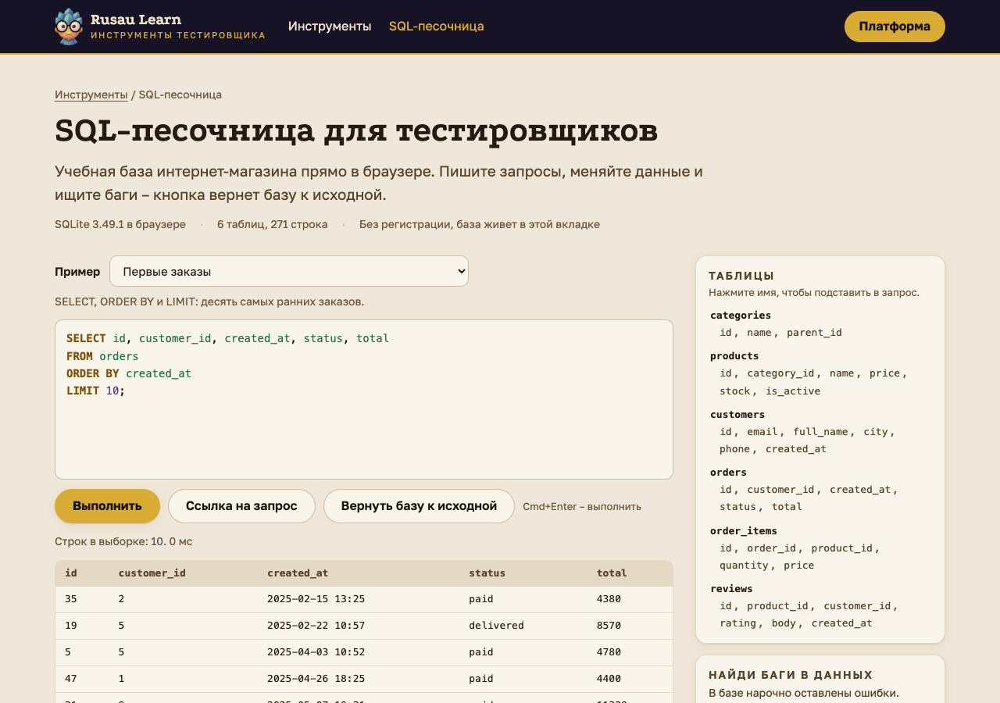
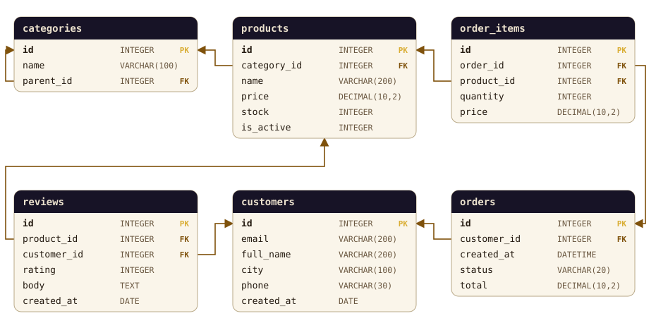
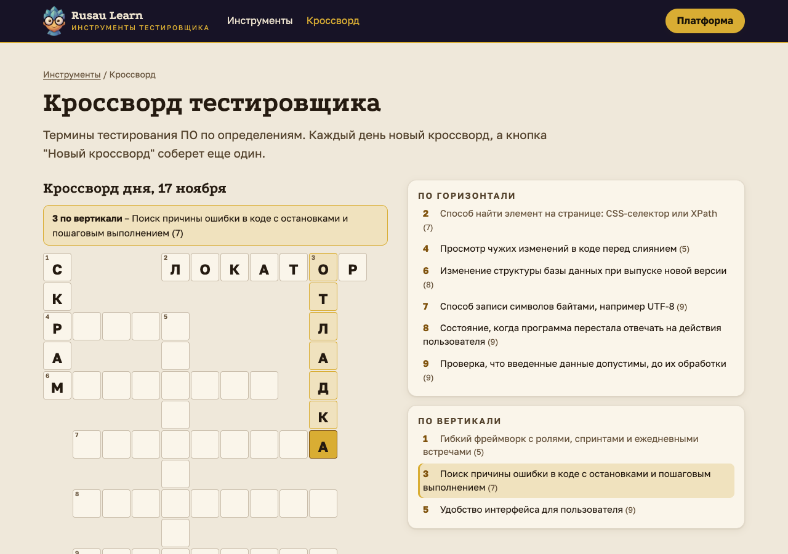
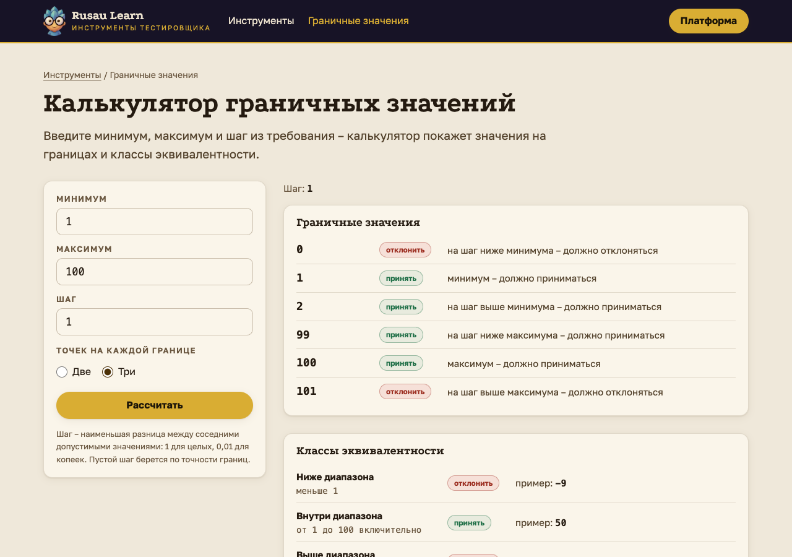
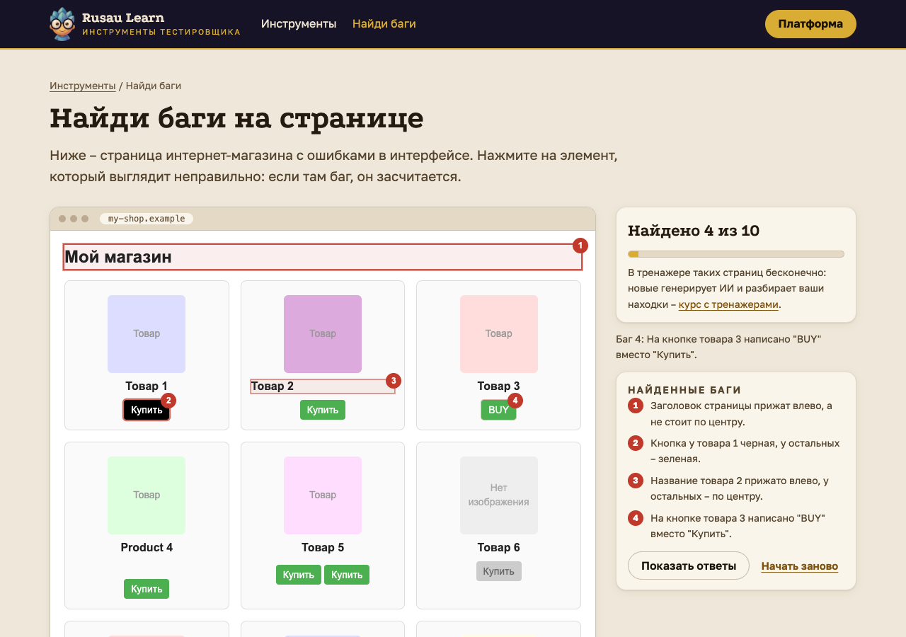

# Инструменты тестировщика

Бесплатные инструменты для практики тестировщика: SQL-песочница, кроссворд, калькулятор граничных значений и поиск багов на странице. Работают в браузере, без регистрации, установки и сервера. Собирает Артем Русов, автор курсов по тестированию на платформе [Rusau Learn](https://learn.rusau.net/?utm_source=github&utm_medium=pages&utm_campaign=gh-qa-tools).

Сайт: https://artichokeee.github.io/qa-tools/

## SQL-песочница

https://artichokeee.github.io/qa-tools/sql/

<!-- Здесь будет GIF с работой песочницы. Пока – снимки из docs/. -->


Учебная база интернет-магазина живет прямо во вкладке: запросы выполняет SQLite, собранный в WebAssembly ([sql.js](https://github.com/sql-js/sql.js)).

- Поле с подсветкой SQL: ключевые слова, строки, числа и имена таблиц базы. Опечатка в имени колонки остается серой.
- Запуск кнопкой или Ctrl+Enter (Cmd+Enter на Mac), результат – таблицей, до 500 строк.
- Ошибки SQLite переведены на русский, исходный текст показан рядом.
- Панель схемы: нажатие на таблицу или колонку подставляет имя в запрос. Созданные вами таблицы тоже видны.
- 12 примеров: SELECT, WHERE, JOIN, GROUP BY, HAVING, подзапрос, WITH RECURSIVE и поиск багов в данных.
- Ссылка на запрос: `?q=` в адресе. Кто откроет ссылку, увидит запрос и сразу его результат.
- Данные можно менять (INSERT, UPDATE, DELETE, CREATE TABLE). Кнопка "Вернуть базу к исходной" сбрасывает все.
- Запросы под MySQL работают: `START TRANSACTION`, `TRUNCATE TABLE`, `AUTO_INCREMENT` и `CAST(x AS SIGNED)` переписываются для SQLite, и песочница показывает, во что.
- Таблица различий MySQL, SQLite и PostgreSQL: где один и тот же запрос даст другой ответ. Каждую строку можно запустить.

### База "интернет-магазин"

Шесть таблиц, 271 строка: `categories`, `products`, `customers`, `orders`, `order_items`, `reviews`. Данные выдуманы и собраны скриптом [`scripts/gen-shop.mjs`](scripts/gen-shop.mjs) с фиксированным сидом, результат – [`sql/shop.sql`](sql/shop.sql).



Схему рисует [`scripts/gen-schema.py`](scripts/gen-schema.py).

### Найди баги в данных

В базу нарочно заложены девять ошибок. Требования, которые они нарушают:

1. email покупателя обязателен;
2. email покупателя уникален;
3. цена товара больше нуля;
4. в заказе есть хотя бы одна позиция;
5. каждая позиция заказа ссылается на существующий товар;
6. заказ оформлен не раньше регистрации покупателя;
7. `total` заказа равен сумме `quantity * price` его позиций;
8. `status` заказа – одно из `new`, `paid`, `shipped`, `delivered`, `cancelled`;
9. оценка в отзыве – от 1 до 5.

Примеры в песочнице находят часть багов. Остальные – найдите сами.

<details>
<summary>Ответы</summary>

| # | Что не так | Где |
|---|---|---|
| 1 | пустой email | `customers.id = 24` |
| 2 | один email у двух покупателей | `customers.id = 12` и `31` |
| 3 | отрицательная цена -390 | `products.id = 17` |
| 4 | оплаченный заказ без позиций | `orders.id = 38` |
| 5 | позиция ссылается на товар 99, которого нет | `order_items.id = 117` (видно и через `PRAGMA foreign_key_check;`) |
| 6 | заказ на месяц раньше регистрации | `orders.id = 21` |
| 7 | `total` больше суммы позиций на 1000 | `orders.id = 9` |
| 8 | статус `Paid` с большой буквы | `orders.id = 14` |
| 9 | оценка 6 | `reviews.id = 9` |

Тест [`tests/data.test.mjs`](tests/data.test.mjs) проверяет, что ответы совпадают с данными.

</details>

### Как это устроено

- Страница – статические файлы без сборки и без фреймворка: HTML, CSS и ES-модули.
- SQLite работает в Web Worker ([`sql/worker.js`](sql/worker.js)). WASM-движок синхронный и изнутри не прерывается, поэтому страница ставит таймер на 3 секунды: если запрос не уложился (например, бесконечный `WITH RECURSIVE`), воркер убивается и создается заново с исходной базой. Вкладка при этом не зависает.
- Перевод MySQL -> SQLite и выполнение запроса – [`sql/sql-shared.js`](sql/sql-shared.js). Показывается последняя выборка запроса, правки считаются строками.
- sql.js 1.14.2 (SQLite 3.49.1) лежит в [`vendor/sql.js`](vendor/sql.js) со своей лицензией MIT. Внешних CDN нет.
- Все пути относительные, поэтому сайт работает и из корня домена, и из подпапки GitHub Pages.

### Запустить у себя

```sh
python3 -m http.server
```

Из корня репозитория, затем откройте http://localhost:8000/sql/ . Открыть `index.html` двойным щелчком не получится: воркеру и WASM нужен HTTP.

Тесты (Node 22 или новее, без зависимостей):

```sh
node --test
```

Пересобрать базу: `node scripts/gen-shop.mjs`.

## Кроссворд тестировщика

https://artichokeee.github.io/qa-tools/crossword/



- Кроссворд дня собирается из даты и одинаков у всех; "Новый кроссворд" берет случайное зерно.
- Ввод с клавиатуры: стрелки, Backspace, Tab к следующему слову, автопереход по слову, повторное нажатие на клетку меняет направление. Буквы набираются и в английской раскладке. На телефоне открывается обычная клавиатура.
- "Проверить" отмечает неверные клетки, "Подсказать букву" открывает одну клетку. Ответы проверяются в браузере.
- Вписанные буквы сохраняются в `localStorage` и переживают перезагрузку.
- Словарь – [`data/glossary.json`](data/glossary.json): 88 терминов от 4 до 9 букв с определениями, написанными для этого кроссворда. Правки и новые термины – через pull request.
- Сборка сетки – [`crossword/layout.js`](crossword/layout.js): слова только пересекаются и никогда не касаются боками, доска всегда связна. Из 40 раскладок берется самая плотная.

## Калькулятор граничных значений

https://artichokeee.github.io/qa-tools/bounds/



- Минимум, максимум и шаг, в том числе дробный (0,01). Пустой шаг берется по точности границ.
- Значения по двум точкам (0, 1, 100, 101) и по трем (0, 1, 2, 99, 100, 101) с пояснением к каждому.
- Классы эквивалентности: ниже, внутри и выше диапазона, с примером из каждого.
- Считается в целых числах, поэтому 0.1 + 0.2 не превращается в 0.30000000000000004: [`bounds/lib.js`](bounds/lib.js).

## Найди баги на странице

https://artichokeee.github.io/qa-tools/bugs/



Страница интернет-магазина с десятью заложенными ошибками интерфейса. Нажатие на элемент засчитывает баг или сообщает, что бага там нет; счетчик показывает "найдено N из 10". Прогресс сохраняется, "Показать ответы" отмечает ненайденное. Ответы – в [`bugs/bugs.js`](bugs/bugs.js).

## Тесты и запуск

Все инструменты – статические файлы без сборки, внешних запросов нет. Запустить у себя: `python3 -m http.server` из корня, затем http://localhost:8000/ . Тесты: `node --test` (Node 22 или новее, без зависимостей) – SQL-песочница, граничные значения, баги на странице, сборка кроссворда и проверка словаря.

## Учиться дальше

- SQL на задачах из работы тестировщика – курс ["Рабочий день тестировщика: тренажер по SQL и задачи на практике"](https://learn.rusau.net/catalog/sql-rabochiy-den?utm_source=github&utm_medium=pages&utm_campaign=gh-qa-tools-sql).
- Тест-дизайн и поиск багов на задачах с разбором – курс ["Тестирование ПО. Тренажеры для тестировщика с ИИ"](https://learn.rusau.net/catalog/prakticheskie-trenazhery?utm_source=github&utm_medium=pages&utm_campaign=gh-qa-tools).
- С нуля – бесплатный курс ["Тестирование с нуля. Теория+Практика. Базовый курс тестировщика"](https://learn.rusau.net/catalog/testirovanie-po-bazovyy?utm_source=github&utm_medium=pages&utm_campaign=gh-qa-tools).

Все курсы – на платформе Rusau Learn.

## Лицензия

[MIT](LICENSE), Artsiom Rusau, 2026. Словарь кроссворда `data/glossary.json` – под той же лицензией. sql.js распространяется под своей лицензией MIT: [`vendor/sql.js/LICENSE`](vendor/sql.js/LICENSE).
